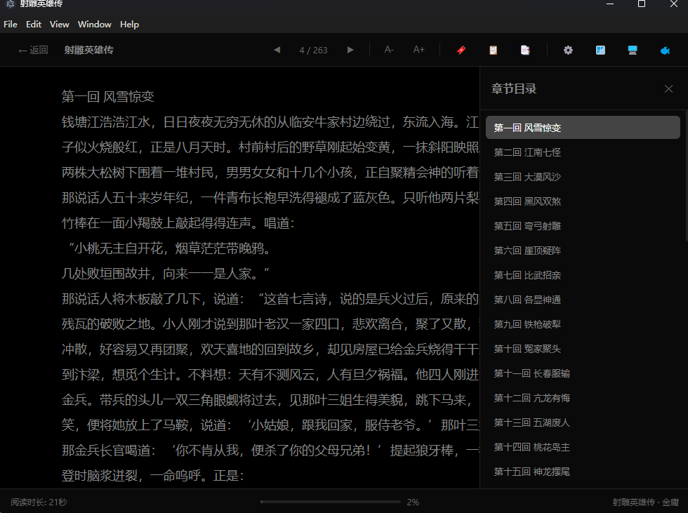
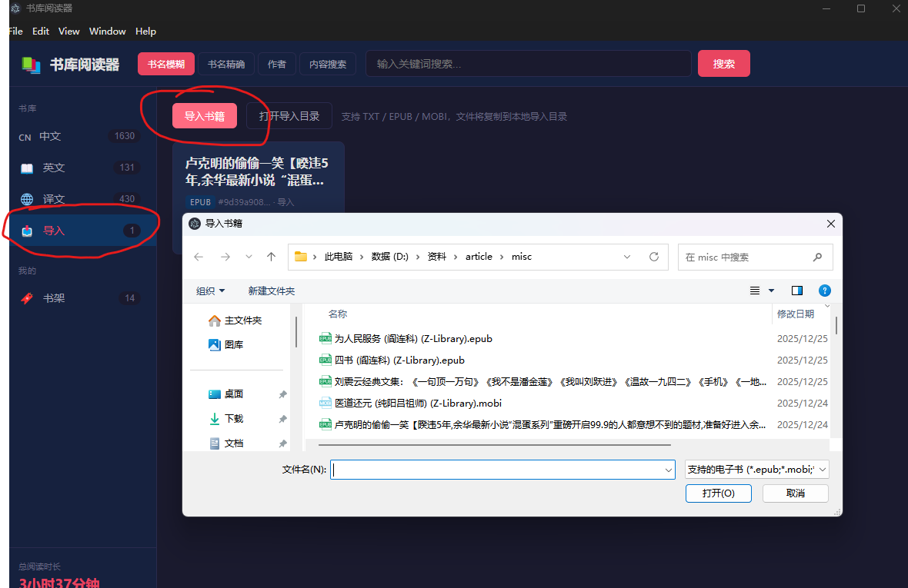
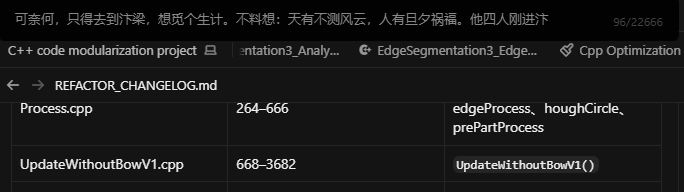
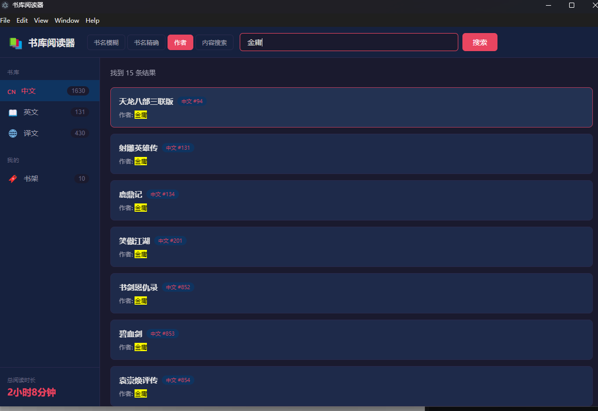
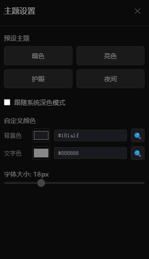

<p align="center">
  
</p>

<h1 align="center">墨域 · InkRealm</h1>

<p align="center">
  Linear reading to hold your attention in the gaps between agent runs<br/>
  An Electron desktop reader · Built-in <a href="https://github.com/doosho/shu">doosho/shu</a> library · TXT / EPUB / MOBI · Window / Fullscreen / Ink Domain modes
</p>

<p align="center">
  <a href="README.md">简体中文</a> ·
  <a href="README.en.md">English</a>
</p>

<p align="center">
  <a href="https://github.com/masterball-w/txt_book_reader/releases/latest"></a>
  <a href="https://github.com/masterball-w/txt_book_reader/releases"></a>
  <a href="LICENSE"></a>
  <a href="https://www.electronjs.org/"></a>
  <a href="https://github.com/masterball-w/txt_book_reader/releases"></a>
  
</p>

<p align="center">
  <a href="https://github.com/masterball-w/txt_book_reader/releases/latest"><strong>Download latest installer</strong></a>
  ·
  <a href="#install--run">Run from source</a>
  ·
  <a href="#changelog">Changelog</a>
</p>

---

## Positioning

Agent-centric work is taking shape, and it is slicing human time into long stretches of waiting. Hand a task over and the model runs; spending those few minutes on sustained thought is plainly wasteful, so the eyes drift to the feed instead — and that is where attention leaks away.

Linear reading offers another kind of transition. A book keeps a fixed pace, recommendation algorithms have no way in, and where you have read to is where you are: one chapter finished is one chapter done. That slow continuity is exactly what fragmented time lacks most.

This project is written for that gap. Window and Fullscreen carry formal reading; Ink Domain presses the text into a narrow strip along the edge of the screen, taking up very little of the view, dressing itself in whatever background color the interface underneath happens to have, paging with `A` / `D` under the left hand while the mouse stays where it is. When a task reminder sounds, lift your eyes and you are back at work; reading position is kept by character offset, and the next launch continues from there.

---

## Highlights

| | |
|:---|:---|
| **Three reading modes** | Window · Fullscreen · Ink Domain (a narrow strip at the screen edge, adapting to the background color, main window retreats to tray, `` Ctrl+` `` to hide) |
| **Built-in library** | cn / en / yi, 2200+ TXT books (third-party open-source library [doosho/shu](https://github.com/doosho/shu)) |
| **Import** | TXT / EPUB / MOBI; embedded images in window & fullscreen for EPUB/MOBI |
| **Reading tools** | Bookmarks, shelf, chapter jump, full-text search, themes & screen color picker, left-hand `A` / `D` paging |



---

## Get started in three minutes

1. Take the Lite build (~80 MB) from [Releases](https://github.com/masterball-w/txt_book_reader/releases/latest), install it and launch from the desktop
2. Pick a book from the shelf, or import your own TXT / EPUB / MOBI from the sidebar
3. `Ctrl + Shift + M` switches into Ink Domain: the text collapses into a narrow strip at the screen edge, and the main window retreats to the system tray
4. Right-click **Automatically adapt to the background** and the strip blends into the color underneath; right-click **Text color** to adjust it further
5. Page with `A` / `D` under the left hand, `` Ctrl+` `` to tuck it away, and right-click **Save bookmark and exit** when you leave

### Automatically adapt to the background


---

## Changelog

Newest first.

### 2026-11-10 · v1.6.0

- **Rename**: the product is now 墨域 / **InkRealm**; installer, desktop shortcut, Start Menu, window title and tray tooltip updated
- **Data directory keeps the legacy name**: `%APPDATA%/书库阅读器/` stays as is, so an existing library, bookmarks and reading progress need no migration
- **README rewritten**: added Positioning, Get started in three minutes, Licensing and distribution and How it was built; the old narrative is gone

Two installers (pick one):

| Edition | File | Best for |
|---------|------|----------|
| Full | [`InkRealm-Setup-1.6.0-Full-x64.exe`](https://github.com/masterball-w/txt_book_reader/releases/tag/v1.6.0) | Unmetered bandwidth, read 2200+ books out of the box |
| Lite | [`InkRealm-Setup-1.6.0-Lite-x64.exe`](https://github.com/masterball-w/txt_book_reader/releases/tag/v1.6.0) | Bandwidth or disk constrained, or want to try before adding the library |

---

### 2026-08-26 · v1.5.1

- **Left-hand paging in Ink Domain**: new `A` / `D` keys — with the right hand parked on the mouse during desktop work, the left hand rests on WASD and turns pages without reaching for the arrow keys; the original `←` / `→` / `PageUp` / `PageDown` / `Space` bindings remain

Two installers (pick one):

| Edition | File | Best for |
|---------|------|----------|
| Full | [`ShuReader-Setup-1.5.1-Full-x64.exe`](https://github.com/masterball-w/txt_book_reader/releases/tag/v1.5.1) | Unmetered bandwidth, read 2200+ books out of the box |
| Lite | [`ShuReader-Setup-1.5.1-Lite-x64.exe`](https://github.com/masterball-w/txt_book_reader/releases/tag/v1.5.1) | Bandwidth or disk constrained, or want to try before adding the library |

---

### 2026-08-20 · v1.5.0

- **Dual installers**: a Full edition and a Lite edition — Lite is only 80 MB (was 900 MB) and ships with 5 sample books
- **Library onboarding for Lite**: an in-app banner walks through three steps (fetch the doosho/shu repository → copy `cn` / `en` / `yi` into the library folder → rescan); sample-book progress carries over seamlessly
- **External library support**: the library folder is now `%APPDATA%/书库阅读器/shu/` first, so a manually placed full library takes effect without reinstalling

---

### 2026-08-19 · v1.4.0

- **Ink Domain context menu**: added "save bookmark and exit" and "match background automatically" — one click samples the screen colour beneath the reading bar and applies it as the theme background, no need to switch back to window mode
- **Text colour in Ink Domain**: the right-click submenu adapts to background lightness and offers 11 syntax-highlighting colours (One Dark palette); contrast is corrected automatically when a background is sampled
- **Position consistency fix**: reading progress now references character offsets, so window ↔ Ink Domain round trips no longer drift
- **Single-book lock on the main view**: a live banner shows "Reading: XXX · XX min"; a second book cannot be opened until the current one is closed
- **Tray hiding**: entering Ink Domain hides the main window to the system tray, leaving only the reading bar in the taskbar and window list; click the tray icon to restore

---

### 2026-07-17 · v1.3.0

- **Rename**: reading mode "Moyu/Stealth" is now **Ink Domain (墨域)** — a homophonic, literary branding; UI labels and icons updated (internal mode id remains `moyu` for compatibility)

Installer: [`ShuReader-Setup-1.3.0-x64.exe`](https://github.com/masterball-w/txt_book_reader/releases/tag/v1.3.0)

---

### 2026-07-17 · v1.2.0

- **Import**: sidebar Import for TXT / EPUB / MOBI → `%APPDATA%/.../imported-books/`
- **Format adapters**: pluggable formats; PDF / AZW3 / FB2 still TODO
- **EPUB/MOBI images**: shown in window/fullscreen; Ink Domain mode stays text-only
- **Local launcher**: `ShuReader.exe` replaces `start.bat` (dev only, not packaged)
- **Build isolation**: `npm run build` vs optional `build:launcher`



Installer: [`ShuReader-Setup-1.2.0-x64.exe`](https://github.com/masterball-w/txt_book_reader/releases/tag/v1.2.0)

---

### 2026-07-13 · v1.1.0

- Ink Domain mode text clipping fix (DOM measure + mid-text sampling + page-number width)
- Chapter-boundary paging; stronger TOC matching
- NSIS installer: custom path, permission checks, install log
- README screenshots

Installer: [`ShuReader-Setup-1.1.0-x64.exe`](https://github.com/masterball-w/txt_book_reader/releases/tag/v1.1.0)

---

### 2026-07-10 · v1.0.0

- Initial release: three reading modes
- Library search, bookmarks/shelf, themes & color picker
- Chapter navigation; line-index progress across modes

---

## Features

### Reading modes


- **Window** — standard window with toolbar
- **Fullscreen** — immersive; toolbar on hover
- **Ink Domain** (墨域) — transparent always-on-top strip; `` Ctrl+` `` to toggle



### Search / bookmarks / themes





### Shortcuts

| Shortcut | Action | Mode |
|----------|--------|------|
| `←` / `PageUp` | Previous page | All |
| `→` / `PageDown` / `Space` | Next page | All |
| `A` | Previous page (left-hand paging) | Ink Domain |
| `D` | Next page (left-hand paging) | Ink Domain |
| `Ctrl + B` | Bookmark | All |
| `` Ctrl + ` `` | Show/hide Ink Domain window | Global |
| `Ctrl + Shift + M` | Open Ink Domain mode | Global |
| `H` | Hide Ink Domain window | Ink Domain |
| `Esc` | Exit fullscreen | Fullscreen |

---

## Install & run

### Option A: Installer (recommended)

Download `InkRealm-Setup-*-x64.exe` from [Releases](https://github.com/masterball-w/txt_book_reader/releases/latest).

### Option B: From source

Requires Node.js 16+.

```bash
git clone --recursive https://github.com/masterball-w/txt_book_reader.git
cd txt_book_reader
npm install
```

| | |
|--|--|
| npm | `npm start` |
| DevTools | `npm run dev` |
| Package installer | `npm run build` |

> Prefer a double-click launcher? Run `npm run build:launcher` to generate `ShuReader.exe` (source in `tools/launcher/`; neither the tool nor its output is packaged).

---

## Project layout

```
txt_book_reader/
├── main.js / preload.js / launch.js
├── lib/                # format adapters & import store
├── src/                # UI
├── tools/launcher/     # optional launcher source (build output not committed)
├── docs/
│   ├── social-preview.png
│   └── screenshots/
└── shu/                # book submodule (cn / en / yi)
```

---

## Book resources

From **[doosho/shu](https://github.com/doosho/shu)**:

| Path | Language | ~Count |
|------|----------|--------|
| `shu/cn/` | Chinese | 1645 |
| `shu/en/` | English | 135 |
| `shu/yi/` | Translated | 424 |

Imported books live under userData `imported-books/`, not inside `shu/`.

### Licensing and distribution

All library content comes from the third-party open-source project [doosho/shu](https://github.com/doosho/shu); copyright in the books remains with their original authors and publishers. This project provides search and presentation as a reading tool only, and claims nothing about the content of the library itself.

For that reason, **new users are advised to start with the Lite build**: the installer contains only 5 sample books, and the full library is placed by the user — clone [doosho/shu](https://github.com/doosho/shu), copy its `cn` / `en` / `yi` folders into `%APPDATA%/书库阅读器/shu/`, then hit Rescan in the app. Shelf structure, reading progress and bookmark format are identical between the Lite and Full builds, so completing the library later needs no reinstall.

---

## How it was built

Requirements breakdown, code, packaging and releases were all produced in collaboration with AI coding assistants; the author is responsible for product judgment and acceptance. There is no model dependency at runtime, it works offline, and all reading data stays local.

---

## Credits

Thanks to [dooshu](https://github.com/doosho) for [doosho/shu](https://github.com/doosho/shu). Book copyrights belong to original authors; this app is a reader only.


## Repository metadata

- **Topics**: electron · ebook-reader · epub · mobi · txt · desktop-app · windows · book-reader · chinese · nsis
- **Social preview**: upload [docs/social-preview.jpg](docs/social-preview.jpg) (1280×640, under 1MB) at [Settings → Social preview](https://github.com/masterball-w/txt_book_reader/settings)

## License

[MIT](LICENSE)