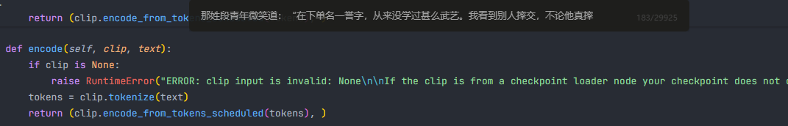
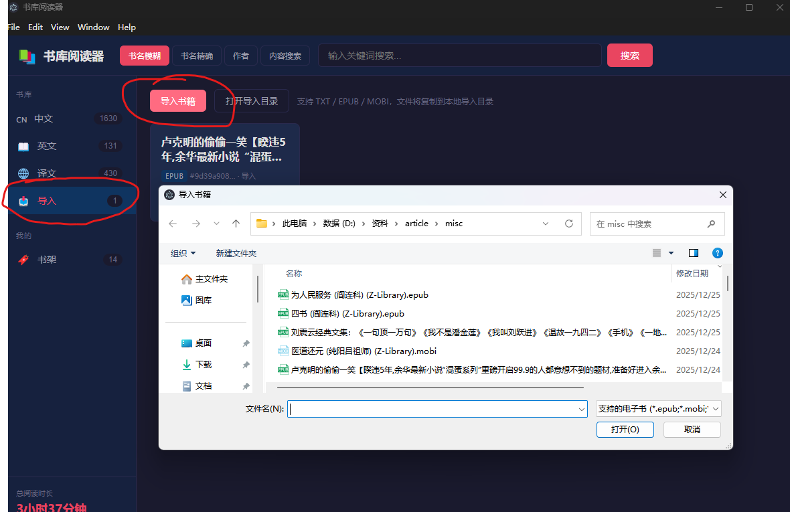
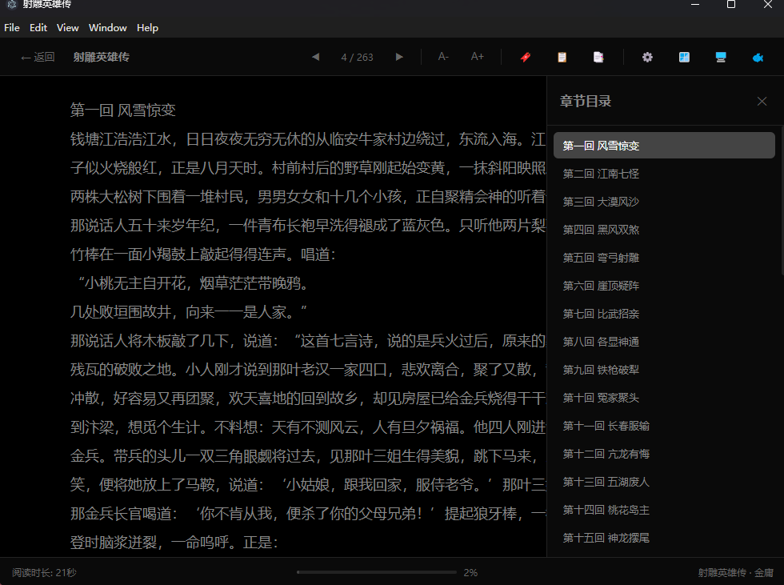
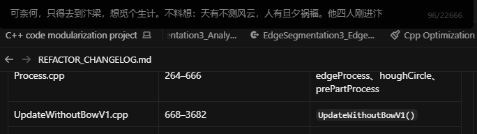
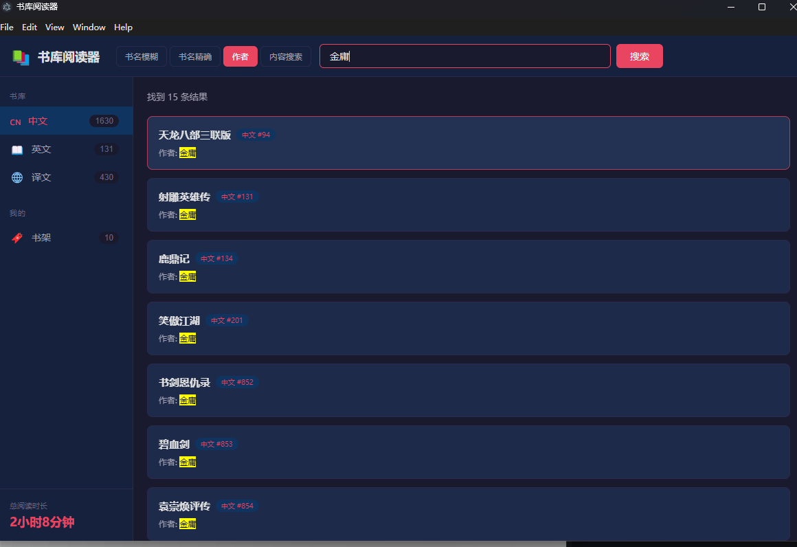
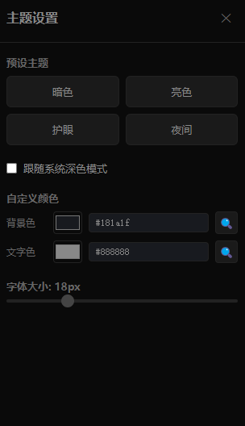

<p align="center">
  
</p>

<h1 align="center">书库阅读器 · ShuReader</h1>

<p align="center">
  基于 Electron 的桌面电子书阅读器<br/>
  内置 <a href="https://github.com/doosho/shu">doosho/shu</a> 书库 · 支持 TXT / EPUB / MOBI · 窗口 / 全屏 / 墨域三模式
</p>

<p align="center">
  <a href="README.md">简体中文</a> ·
  <a href="README.en.md">English</a>
</p>

<p align="center">
  <a href="https://github.com/masterball-w/txt_book_reader/releases/latest"></a>
  <a href="https://github.com/masterball-w/txt_book_reader/releases"></a>
  <a href="LICENSE"></a>
  <a href="https://www.electronjs.org/"></a>
  <a href="https://github.com/masterball-w/txt_book_reader/releases"></a>
  
</p>

<p align="center">
  <a href="https://github.com/masterball-w/txt_book_reader/releases/latest"><strong>下载最新安装包</strong></a>
  ·
  <a href="#安装与运行">从源码运行</a>
  ·
  <a href="#更新日志">更新日志</a>
</p>

---

## 亮点

| | |
|:---|:---|
| **三种阅读模式** | 窗口 · 全屏 · 墨域（透明置顶长条，主界面自动隐入托盘，`` Ctrl+` `` 隐藏） |
| **内置书库** | cn / en / yi，约 2200+ 本 TXT（[doosho/shu](https://github.com/doosho/shu)） |
| **外部导入** | TXT / EPUB / MOBI；窗口与全屏支持 EPUB/MOBI 插图 |
| **阅读辅助** | 书签、书架、章节跳转、全文搜索、主题与屏幕取色、墨域右键改色 |


---

## 更新日志

按日期倒序，最新在上。

### 2026-08-26 · v1.5.1

- **墨域左手翻页**：新增 `A` / `D` 左手翻页键——摸鱼场景右手握鼠标，左手用 WASD 落位即可翻页，无需跨屏按方向键；原 `←` / `→` / `PageUp` / `PageDown` / `空格` 翻页保持不变

安装包（二选一）：

| 版本 | 文件 | 适合人群 |
|------|------|----------|
| 完全体 | [`ShuReader-Setup-1.5.1-Full-x64.exe`](https://github.com/masterball-w/txt_book_reader/releases/tag/v1.5.1) | 网络不限、想开箱即读 2200+ 本 |
| 轻量版 | [`ShuReader-Setup-1.5.1-Lite-x64.exe`](https://github.com/masterball-w/txt_book_reader/releases/tag/v1.5.1) | 带宽 / 磁盘敏感，或想先试用再装书库 |

---

### 2026-08-20 · v1.5.0

- **双版本安装包**：提供「完全体 / 轻量版」两种安装包，轻量版仅 80 MB（原 900 MB），内置 5 本示例书
- **轻量版书库引导**：应用内横幅引导三步完成完整书库安装（获取 doosho/shu 仓库 → 复制 `cn` / `en` / `yi` 到书库目录 → 重新扫描），示例书进度与完整库无缝衔接
- **外部书库支持**：书库目录改为 `%APPDATA%/书库阅读器/shu/` 优先，手动放置的完整书库自动生效，无需重装应用

安装包（二选一）：

| 版本 | 文件 | 适合人群 |
|------|------|----------|
| 完全体 | [`ShuReader-Setup-1.5.0-Full-x64.exe`](https://github.com/masterball-w/txt_book_reader/releases/tag/v1.5.0) | 网络不限、想开箱即读 2200+ 本 |
| 轻量版 | [`ShuReader-Setup-1.5.0-Lite-x64.exe`](https://github.com/masterball-w/txt_book_reader/releases/tag/v1.5.0) | 带宽 / 磁盘敏感，或想先试用再装书库 |

---

### 2026-08-19 · v1.4.0

- **墨域右键增强**：新增「保存书签并退出」与「自动适配背景色」——一键捕获阅读条下层的屏幕背景色并应用为主题背景，无需切回窗口模式手动取色
- **墨域文字颜色**：右键「文字颜色」子菜单支持随背景明暗自动适配，并提供 11 种语法高亮常用色（One Dark 色板）；适配背景色时若文字对比度不足会自动联动调整
- **位置一致性修复**：阅读进度统一以字符偏移为参照，窗口 ↔ 墨域往返切换不再漂移
- **主视图单本锁**：阅读中显示「正在阅读：XXX · 已阅读 XX分钟」实时横幅；退出当前书之前不支持打开第二本
- **托盘隐身**：进入墨域模式后主界面自动隐藏到系统托盘（防 Alt+Tab 暴露），点击托盘图标即可恢复

**「自动适配背景色」动态演示**：


**效果对比**：

| 适配前 | 适配后 |
|:---:|:---:|
|  |  |

安装包：[`ShuReader-Setup-1.4.0-x64.exe`](https://github.com/masterball-w/txt_book_reader/releases/tag/v1.4.0)

---

### 2026-07-17 · v1.3.0

- **品牌更名**：阅读模式「摸鱼」正式更名为「墨域」——谐音双关，取墨香书域之意，界面文案与图标同步更新（内部模式标识仍为 `moyu`，兼容已有进度数据）

安装包：[`ShuReader-Setup-1.3.0-x64.exe`](https://github.com/masterball-w/txt_book_reader/releases/tag/v1.3.0)

---

### 2026-07-17 · v1.2.0

- **外部导入**：侧栏「导入」支持 TXT / EPUB / MOBI；文件落在用户目录 `imported-books/`
- **格式适配器**：可平行扩展；PDF / AZW3 / FB2 等为 TODO
- **EPUB/MOBI 插图**：窗口与全屏显示内嵌图片；墨域模式仍为纯文本
- **本地启动器**：`ShuReader.exe` 替代 `start.bat`（仅源码目录用，不进安装包）
- **构建隔离**：`npm run build` 与 `build:launcher` 相互独立



安装包：[`ShuReader-Setup-1.2.0-x64.exe`](https://github.com/masterball-w/txt_book_reader/releases/tag/v1.2.0)

---

### 2026-07-13 · v1.1.0

- 墨域模式吞字修复（DOM 测量 + 中间取样 + 页码预留宽度）
- 窗口 / 全屏按章节边界分页；章节解析与 TOC 匹配增强
- NSIS 安装包：自定义路径、权限检查、安装日志
- README 融入功能截图

安装包：[`ShuReader-Setup-1.1.0-x64.exe`](https://github.com/masterball-w/txt_book_reader/releases/tag/v1.1.0)

---

### 2026-07-10 · v1.0.0

- 初版：窗口 / 全屏 / 墨域三模式
- 内置书库检索、书签书架、主题与屏幕取色
- 章节跳转；跨模式以行索引统一进度

---

## 功能概览

### 阅读模式


- **窗口模式** — 标准窗口，工具栏可操作
- **全屏模式** — 沉浸阅读，悬停显示工具栏
- **墨域模式** — 透明置顶长条，`` Ctrl+` `` 一键隐藏





### 搜索 / 书签 / 主题





- 书名模糊 / 精确、作者、全文搜索
- 书签、书架、阅读时长
- 暗色 / 亮色 / 护眼 / 夜间；屏幕取色；跟随系统

### 快捷键

| 快捷键 | 功能 | 模式 |
|--------|------|------|
| `←` / `PageUp` | 上一页 | 全部 |
| `→` / `PageDown` / `空格` | 下一页 | 全部 |
| `A` | 上一页（左手翻页） | 墨域 |
| `D` | 下一页（左手翻页） | 墨域 |
| `Ctrl + B` | 保存书签 | 全部 |
| `` Ctrl + ` `` | 显示/隐藏墨域窗口 | 全局 |
| `Ctrl + Shift + M` | 打开墨域模式 | 全局 |
| `H` | 隐藏墨域窗口 | 墨域 |
| `Esc` | 退出全屏 | 全屏 |

---

## 安装与运行

### 方式一：安装包（推荐）

打开 [Releases](https://github.com/masterball-w/txt_book_reader/releases/latest)，按需选择版本：

| 版本 | 文件名 | 体积 | 内容 |
|------|--------|------|------|
| **完全体** | `ShuReader-Setup-<版本>-Full-x64.exe` | 约 900 MB | 内置完整书库（2200+ 本），安装即读，全程离线 |
| **轻量版** | `ShuReader-Setup-<版本>-Lite-x64.exe` | 约 80 MB | 仅内置 5 本示例书，完整书库按需手动安装（见下） |

安装后从桌面或开始菜单启动。

#### 轻量版如何升级为完整书库

轻量版首次启动会在顶部显示引导横幅，三个按钮完成全部操作：

1. 点击 **「获取完整书库」** —— 浏览器打开 [doosho/shu](https://github.com/doosho/shu) 仓库，点 `Code → Download ZIP` 下载（约 2.5 GB）
2. 点击 **「打开书库目录」** —— 打开书库文件夹 `%APPDATA%/书库阅读器/shu/`
3. 将 ZIP 解压出的 `cn` / `en` / `yi` 三个文件夹复制进书库目录，回到应用点击 **「重新扫描」**

完成后书架即刻显示 2200+ 本藏书；示例书的阅读进度与书签自动衔接（两种书库 bookid 一致）。不想手动下载的话，直接装完全体安装包即可。

### 方式二：源码运行

需要 Node.js 16+。

```bash
git clone --recursive https://github.com/masterball-w/txt_book_reader.git
cd txt_book_reader
npm install
```

| 方式 | 命令 / 操作 |
|------|-------------|
| Windows | `npm start` |
| 开发（DevTools） | `npm run dev` |
| 打完全体安装包 | `npm run build:full` → `dist/ShuReader-Setup-<版本>-Full-x64.exe` |
| 打轻量版安装包 | `npm run build:lite` → `dist/ShuReader-Setup-<版本>-Lite-x64.exe`（示例书清单见 `tools/build-lite-books.js`） |

> 想要双击即用的本地启动器，可运行 `npm run build:launcher` 生成 `ShuReader.exe`（源码见 `tools/launcher/`，产物与工具均不进入安装包）。

---

## 项目结构

```
txt_book_reader/
├── main.js / preload.js / launch.js
├── lib/                # 格式适配器与导入书库
├── src/                # 书库 UI 与阅读器
├── tools/launcher/     # 启动器源码（可选，编译产物不进版本库）
├── docs/
│   ├── social-preview.png
│   └── screenshots/
└── shu/                # Git 子模块书库（cn / en / yi）
```

---

## 书库资源

来自 **[doosho/shu](https://github.com/doosho/shu)**：

| 目录 | 说明 | 约数量 |
|------|------|--------|
| `shu/cn/` | 中文 | 1645 |
| `shu/en/` | 英文 | 135 |
| `shu/yi/` | 译文 | 424 |

本地导入保存在 `%APPDATA%/书库阅读器/imported-books/`，不写入 `shu/`。

轻量版用户手动放置的完整书库目录为 `%APPDATA%/书库阅读器/shu/`（与安装包内置书库同结构），放置后应用内点击「重新扫描」即生效。

---

## 致谢

感谢 [dooshu](https://github.com/doosho) 的开源书库 [doosho/shu](https://github.com/doosho/shu)。书籍版权归原作者；本项目仅作阅读工具。


## 仓库元数据

- **Topics**：electron · ebook-reader · epub · mobi · txt · desktop-app · windows · book-reader · chinese · nsis
- **Social preview**：请将 [docs/social-preview.jpg](docs/social-preview.jpg)（1280×640，<1MB）上传到 [仓库 Settings → Social preview](https://github.com/masterball-w/txt_book_reader/settings)

## License

[MIT](LICENSE)